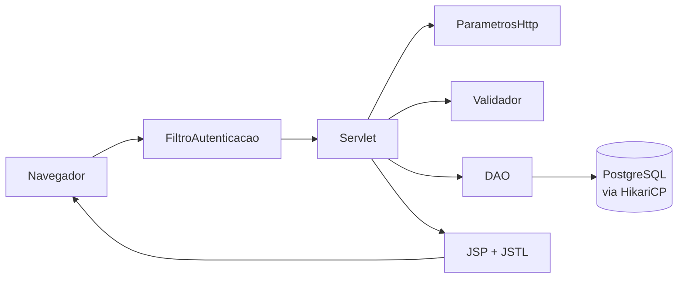

# Inventra

Sistema web de **gestão de estoque e compras** para pequenas operações: cadastro de fornecedores, produtos, lotes, funcionários, requisições e pré-lista de compras, com controle de validade dos lotes e acesso restrito a administradores.

Projeto do 1º ano desenvolvido pela equipe **InventraTech** para as disciplinas de **POO** (Programação Orientada a Objetos) e **LPR** (Lógica de Programação).


---

## Sumário

- [O que o sistema faz](#o-que-o-sistema-faz)
- [Tecnologias](#tecnologias)
- [Arquitetura](#arquitetura)
- [Estrutura do projeto](#estrutura-do-projeto)
- [Como executar](#como-executar)
- [Rotas e filtros](#rotas-e-filtros)
- [Modelo de dados](#modelo-de-dados)
- [Segurança](#segurança)
- [Validação e tratamento de erros](#validação-e-tratamento-de-erros)
- [Padrões de código](#padrões-de-código)
- [Fluxo de trabalho com Git](#fluxo-de-trabalho-com-git)
- [Limitações conhecidas](#limitações-conhecidas)

---

## O que o sistema faz

| Módulo | O que permite |
|---|---|
| **Fornecedores** | Cadastro com CNPJ, e-mail, endereço (estado e cidade) e nota VPQ. Resumo com total de fornecedores, média das notas e fornecedores com produtos vinculados. |
| **Produtos** | Catálogo de produtos (marca, categoria, fornecedor, unidade de medida, estoque mínimo e máximo, status ativo). Quantidade e validade **não** ficam aqui: pertencem ao lote. |
| **Lotes** | Cada entrada de produto, com número do lote, quantidade inicial e atual, datas de entrada e validade, valor de compra e nota fiscal. |
| **Funcionários** | Cadastro com setor, CPF, e-mail, data de admissão, status e perfil de administrador. |
| **Requisições** | Pedidos de produtos feitos por um funcionário e aprovados por outro, com tipo, quantidade, motivo e status. |
| **Pré-lista** | Itens a comprar, por fornecedor e produto, com quantidade. |

Recursos presentes em todas as telas de listagem:

- **Paginação** e **filtros de ordenação**.
- **Exportação em CSV** respeitando o filtro escolhido (o arquivo sai completo, sem paginação).
- **Cadastro, edição completa, edição de uma única coluna e exclusão.**
- **Sino de notificações** no cabeçalho: mostra os lotes com validade mais próxima e os totais de lotes **vencidos** e **vencendo em 30 dias**.
- Mensagens de erro de validação exibidas na própria tela, sem perder o contexto.

---

## Tecnologias

| Camada | Tecnologia |
|---|---|
| Linguagem | Java 25 |
| Web | Jakarta Servlet 6.0, JSP e JSTL 3.0 |
| Servidor | Apache Tomcat 11 |
| Banco de dados | PostgreSQL (driver 42.7.3) |
| Pool de conexões | HikariCP 5.1.0 |
| Senhas | bcrypt (`at.favre.lib:bcrypt` 0.10.2) |
| Configuração | `dotenv-java` 3.2.0 (arquivo `.env`) |
| Logs | Logback 1.2.13 |
| Build | Maven (wrapper incluído) — empacotamento WAR |

---

## Arquitetura

O projeto segue o padrão em camadas, com responsabilidades separadas por pacote:



1. O **filtro de autenticação** intercepta toda requisição e só libera rotas públicas ou administradores logados.
2. O **servlet** recebe a requisição. Para listagens (`GET`), consulta o DAO e encaminha ao JSP. Para ações (`POST`), lê os parâmetros com `ParametrosHttp`.
3. O **validador** confere os dados e devolve a lista de mensagens de erro. Se houver erro, nada é gravado: as mensagens vão para a sessão (`mensagemErro`) e o usuário volta para a lista.
4. O **DAO** executa o SQL com `PreparedStatement` e `try-with-resources`, usando conexões emprestadas do pool.
5. O **JSP** (com JSTL e EL) renderiza a tela a partir dos objetos de `model`.

Os modelos (`*Molde`) têm construtores sobrecarregados para cada situação: cadastro (sem id), edição (com id e chaves estrangeiras) e leitura com `JOIN` (com os nomes no lugar das chaves).

---

## Estrutura do projeto

```
Inventra-POO/
├── pom.xml
├── mvnw / mvnw.cmd                  # Maven Wrapper
└── src/main/
    ├── java/org/inventra/
    │   ├── conexao/                 # ConexaoBanco: pool HikariCP
    │   ├── dao/                     # Acesso ao banco (um DAO por tabela principal)
    │   ├── model/                   # Classes de modelo (*Molde)
    │   ├── servlet/                 # Servlets, login/logout e FiltroAutenticacao
    │   ├── utils/                   # ParametrosHttp, SenhaUtil, NotificacaoLotes, REGEX
    │   └── validation/              # Validadores por entidade
    ├── resources/
    │   └── .env                     # Credenciais do banco (NÃO é versionado)
    └── webapp/
        ├── index.html               # Página inicial pública
        ├── login.jsp                # Tela de login
        ├── paginas/                 # Páginas institucionais (suporte, privacidade...)
        └── WEB-INF/
            ├── web.xml              # Páginas de erro (400, 403, 404, 405, 500)
            ├── fornecedor/ funcionarios/ lotes/ pre-lista/ produto/ requisicao/
            └── views/erros/         # JSPs das páginas de erro
```

---

## Como executar

### Pré-requisitos

- **JDK 25**
- **PostgreSQL** em execução, com um banco criado para o projeto
- **Apache Tomcat 11**
- IntelliJ IDEA (recomendado) ou Maven pela linha de comando

### 1. Clonar o repositório

```bash
git clone https://github.com/InventraTech/inventra-poo-lpr-1.git
cd inventra-poo-lpr-1
```

### 2. Configurar o banco

Crie as tabelas descritas em [Modelo de dados](#modelo-de-dados) no seu banco PostgreSQL.

Depois crie o arquivo `src/main/resources/.env` (ele está no `.gitignore`, então suas credenciais não vão para o GitHub):

```env
DB_URL=jdbc:postgresql://localhost:5432/NOME_DO_BANCO
DB_USUARIO=seu_usuario
DB_SENHA=sua_senha
```

### 3. Criar o primeiro administrador

O sistema não tem cadastro público: o login só aceita funcionários com `is_admin = true` e `status = 'Ativo'`. Para o primeiro acesso, insira um funcionário com esses valores diretamente no banco, com a senha já em formato **hash bcrypt (custo 12)**. O hash pode ser gerado com `SenhaUtil.gerarHash("sua_senha")`. Os demais funcionários podem ser cadastrados depois, pela própria tela.

### 4. Compilar

```bash
./mvnw -DskipTests package        # Linux/macOS
.\mvnw.cmd -DskipTests package    # Windows (PowerShell)
```

O WAR é gerado em `target/Inventra-1.0-SNAPSHOT.war`.

### 5. Executar no Tomcat

**IntelliJ IDEA:** crie uma configuração *Tomcat Server → Local*, adicione o artefato `Inventra:war exploded` e defina o *Application context* como `/Inventra`.

**Manual:** copie o WAR para a pasta `webapps` do Tomcat 11 e inicie o servidor. O contexto será o nome do arquivo; renomeie o WAR para `Inventra.war` para manter o endereço abaixo.

Acesse: <http://localhost:8080/Inventra/login.jsp>

> Se você alterou classes ou JSPs com o Tomcat rodando, reinicie o servidor ou faça um *redeploy* para as mudanças valerem.

---

## Rotas e filtros

Todas as rotas abaixo (exceto `/login`) exigem sessão de administrador.

| Rota | Função |
|---|---|
| `/login` | `POST` autentica; `GET` volta para a tela de login |
| `/logout` | Encerra a sessão |
| `/fornecedor` | Fornecedores |
| `/produto` | Produtos |
| `/lote` | Lotes |
| `/funcionario` | Funcionários |
| `/requisicao` | Requisições |
| `/itemprelista` | Itens da pré-lista |

**Parâmetros de listagem (`GET`):** `filtro`, `pagina` e `acao=exportar` (gera o CSV).

**Ações (`POST`), campo `acao`:** `excluir`, `atualizar_coluna`, `atualizar_completo`. Qualquer outro valor é tratado como cadastro.

**Filtros disponíveis por tela:**

| Tela | Valores de `filtro` |
|---|---|
| Fornecedores | `notaVPQ_crescente`, `notaVPQ_decrescente` |
| Produtos | `az`, `za`, `marca` |
| Lotes | `entrada_crescente`, `entrada_decrescente`, `validade_crescente`, `validade_decrescente`, `produtos_atual` |
| Funcionários | `az`, `za`, `setor`, `data_crescente`, `data_decrescente` |
| Requisições | `tipo`, `quantidade_crescente`, `quantidade_decrescente`, `data_proxima`, `data_distante` |
| Pré-lista | `fornecedor`, `produto`, `quantidade_crescente`, `quantidade_decrescente` |

Exemplos:

```
/Inventra/lote?filtro=validade_crescente&pagina=2
/Inventra/lote?filtro=validade_crescente&acao=exportar
```

---

## Modelo de dados

Tabelas e colunas utilizadas pelo código (PostgreSQL):

| Tabela | Colunas principais |
|---|---|
| `fornecedor` | `id_fornecedor`, `fk_endereco`, `nome_juridico`, `cnpj`, `email`, `nota_vpq` |
| `endereco` | `id_endereco`, `estado`, `cidade` |
| `produto` | `id_produto`, `fk_fornecedor`, `fk_marca`, `fk_categoria`, `nome`, `unidade_medida`, `estoque_min`, `estoque_max`, `descricao`, `ativo` |
| `marca` | `id_marca`, `nome` |
| `categoria` | `id_categoria`, `nome` |
| `lote` | `id_lote`, `fk_produto`, `numero_lote`, `qtd_inicial`, `qtd_atual`, `dt_entrada`, `dt_validade`, `valor_compra`, `nota_fiscal` |
| `funcionario` | `id_funcionario`, `fk_setor`, `nome`, `senha` (hash), `email`, `cpf`, `dt_admissao`, `status`, `is_admin` |
| `setor` | `id_setor`, `nome` |
| `requisicao` | `id_requisicao`, `fk_tipo_requisicao`, `fk_funcionario_solicitante`, `fk_funcionario_aprovador`, `fk_produto`, `quantidade_prod`, `motivo`, `status`, `dt_requisicao` |
| `tipo_requisicao` | `id_tipo_requisicao`, `tipo` |
| `item_pre_lista` | `id_item_lista`, `fk_pre_lista`, `fk_fornecedor`, `fk_produto`, `qtd` |

As telas de listagem usam `JOIN` para exibir nomes (marca, categoria, setor, produto...) no lugar das chaves estrangeiras.

---

## Segurança

- **Autenticação e autorização:** `FiltroAutenticacao` intercepta `/*`. Sem sessão, redireciona para o login; com sessão de não administrador, responde 403.
- **Senhas:** guardadas apenas como hash **bcrypt (custo 12)**; a senha nunca é gravada em texto puro nem mantida na sessão.
- **Sessão:** o ID é trocado no login (proteção contra *session fixation*) e a sessão expira após 30 minutos de inatividade.
- **SQL:** consultas com `PreparedStatement`. Na edição por coluna, o nome da coluna precisa ser concatenado ao SQL; por isso cada servlet aceita só uma **lista fechada de colunas editáveis** e recusa qualquer outro nome antes de chegar ao banco.
- **Credenciais:** usuário e senha do banco ficam no `.env`, fora do versionamento.
- **Mensagens:** o login não revela se o e-mail ou a senha foi o que falhou.

---

## Validação e tratamento de erros

- **Pacote `validation`:** um validador por entidade (`ProdutoValidador`, `LoteValidador`, `RequisicaoValidador`, `ItemPreListaValidador`, `FuncionarioValidador`, `FornecedorValidador`). Cada um devolve a lista de mensagens de erro; lista vazia significa dados válidos.
- **`ParametrosHttp`:** leitura defensiva de parâmetros (inteiros, datas, decimais, booleanos). Em vez de lançar exceção, registra a mensagem e devolve um valor neutro, para o usuário ver todos os problemas de uma vez.
- **REGEX:** CPF, CNPJ e e-mail são conferidos **apenas quanto ao formato**; os dígitos verificadores do CPF e do CNPJ não são calculados.
- **Regras de negócio:** por exemplo, a quantidade atual do lote não pode superar a inicial, a validade não pode ser anterior à entrada, o estoque mínimo não pode superar o máximo e o solicitante não pode aprovar a própria requisição.
- **Erros de banco e do servidor:** os DAOs lançam `RuntimeException` com mensagem clara; o contêiner mostra as páginas de erro configuradas no `web.xml` (400, 403, 404, 405 e 500).

---

## Padrões de código

- **Nomes:** `camelCase` para variáveis, campos e métodos; `PascalCase` para classes; `UPPER_SNAKE_CASE` para constantes. Os nomes das colunas do banco e dos parâmetros HTTP (`fk_setor`, `dt_validade`...) foram mantidos como estão, e o código Java faz a conversão.
- **Comentários:** explicam o porquê das decisões (regras de negócio, joins, permissões), não repetem o que o código já diz. Classes e métodos públicos de comportamento não trivial têm Javadoc.
- **Camadas:** sem SQL nos servlets nem regra de tela nos DAOs.

---

## Fluxo de trabalho com Git

- Desenvolvimento em branches `feature/...`, integradas à `main` por **Pull Request**.
- Mensagens de commit no padrão **Conventional Commits** (`feat:`, `fix:`, `refactor:`, `docs:`...), por exemplo `fix(dao): corrige atualização completa de lote`.
- Após uma PR ser integrada, crie a próxima branch a partir da `main` atualizada.

---

## Limitações conhecidas

- O projeto **não tem testes automatizados**; a verificação foi feita manualmente.
- Excluir um registro que é referenciado por outra tabela (por exemplo, um fornecedor com produtos) falha no banco e cai na página de erro 500, ainda sem mensagem amigável.
- O script SQL de criação do banco ainda não faz parte do repositório; use a tabela em [Modelo de dados](#modelo-de-dados) como referência.
